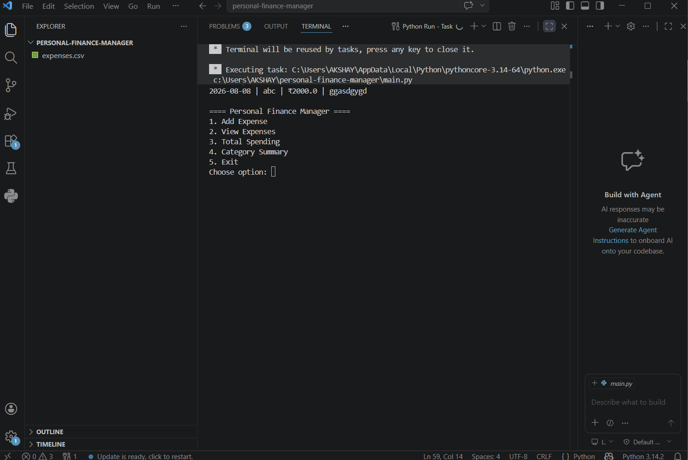
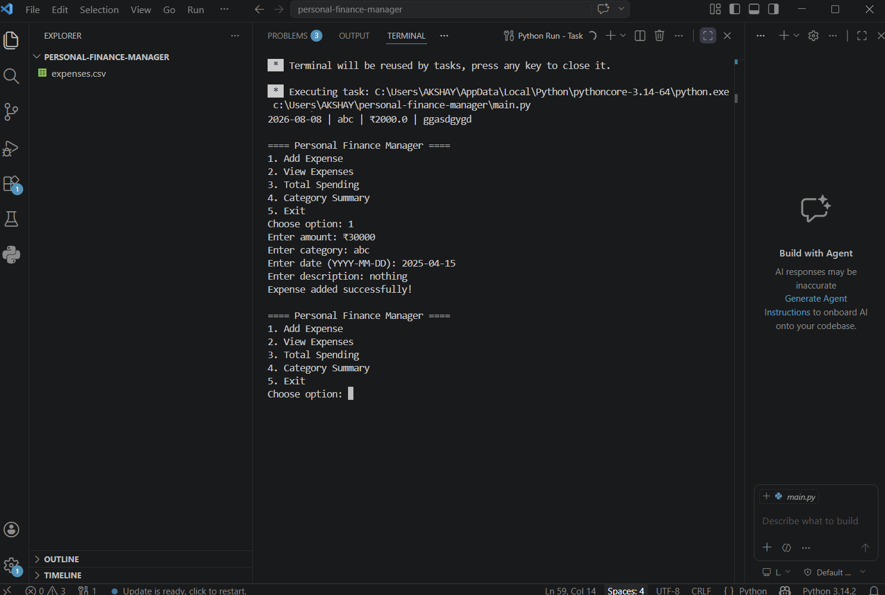
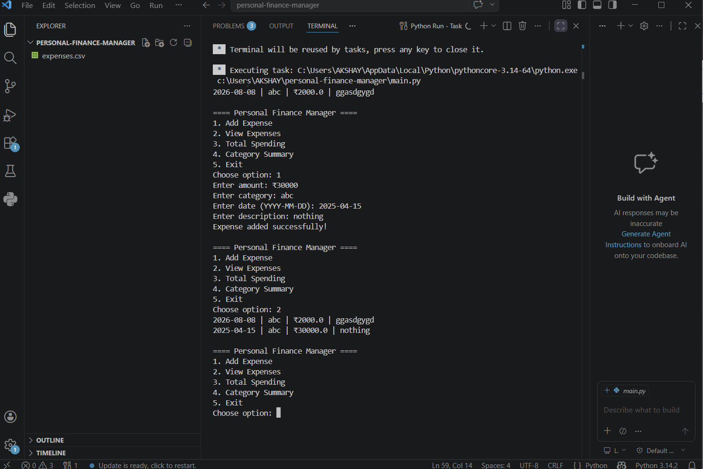
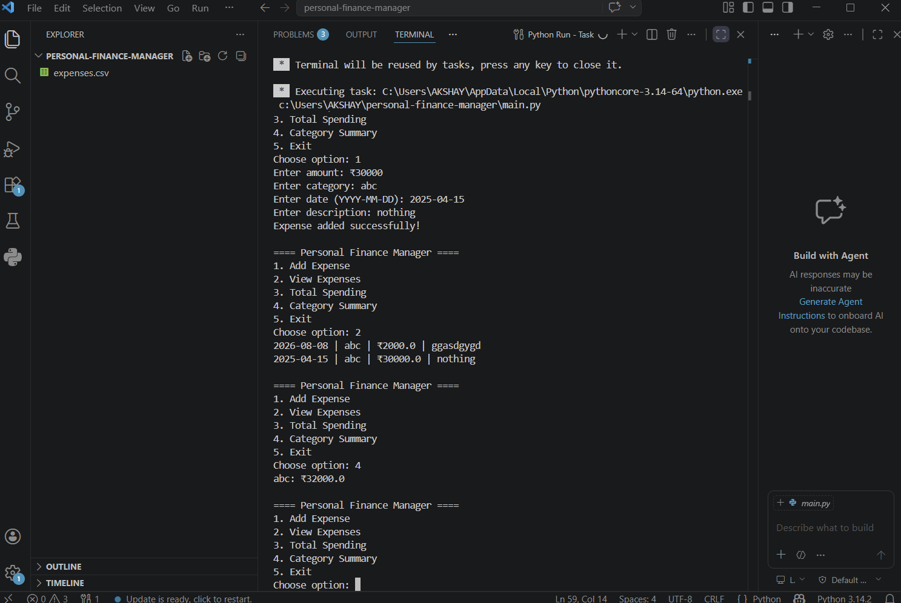

# 💰 Personal Finance Manager

## 📌 Project Overview
A command-line based personal finance management system built using Python. It helps users track expenses, analyze spending patterns, and generate reports.

## 🎯 Objectives
- Track daily expenses
- Store data persistently using CSV
- Provide summaries and insights
- Use object-oriented programming principles

---

## ⚙️ Installation Guide

1. Install Python (>=3.7)
2. Clone repository:
   git clone <repo-url>
3. Navigate to folder:
   cd personal-finance-manager
4. Run application:
   python main.py

---

## 🧱 Code Structure

- `main.py` → CLI interface
- `expense.py` → Expense class
- `manager.py` → Business logic & file handling
- `expenses.csv` → Data storage

---

## 📊 Features Implemented

✅ Expense class (amount, category, date, description)  
✅ CSV file handling  
✅ Data persistence  
✅ Error handling  
✅ CLI interface  
✅ Category-wise summary  
✅ Total spending calculation  
✅ Input validation  

---

## 🖥️ Example Output

---

## 🧩 How Requirements Are Met

| Requirement | Implementation |
|------------|--------------|
| OOP Design | Expense & FinanceManager classes |
| File Handling | CSV read/write |
| Error Handling | try-except blocks |
| CLI Interface | Menu-driven system |
| Data Persistence | expenses.csv |

---

## ⚠️ Troubleshooting

**Problem:** File not saving  
→ Ensure write permissions

**Problem:** Invalid input  
→ Follow input format strictly

**Problem:** CSV not loading  
→ Check file exists or delete and restart

---

## 🚀 Future Improvements
- GUI using Tkinter
- Graphs & analytics
- Monthly budget tracking

## 📸 Screenshots

### 🏠 Main Menu

### ➕ Add Expense

### 📋 View Expenses

### 📊 Category Summary
